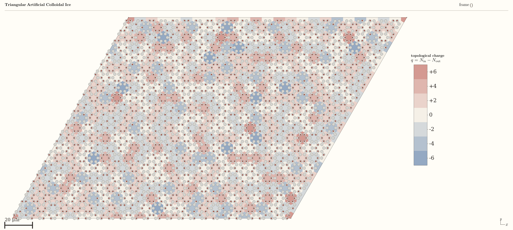
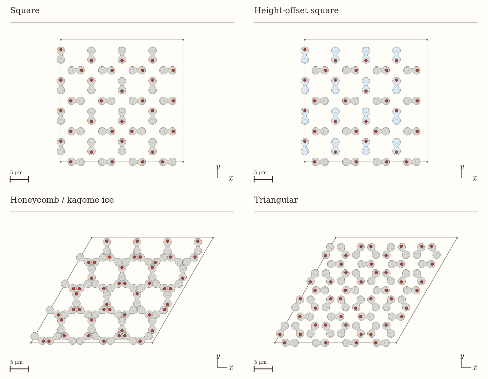
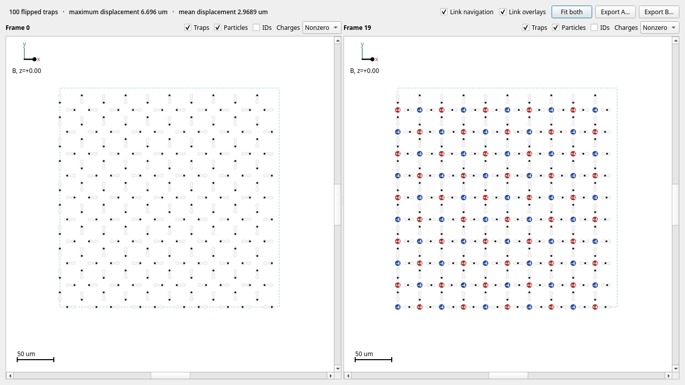
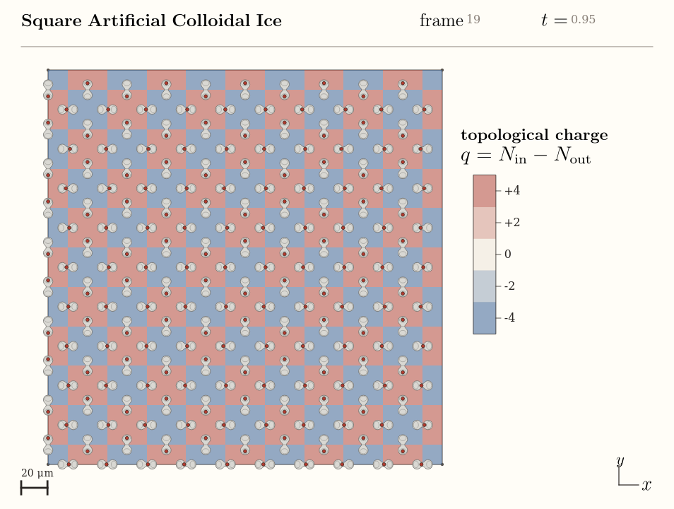

# ACI State Builder

**Configuration preparation and trajectory visualization for artificial colloidal ice.**

Artificial colloidal ice consists of interacting colloidal particles confined
in arrays of bistable traps, providing an experimentally accessible system for
studying geometric frustration, ice rules, and topological defects. Its
experimental realization was introduced by
[Ortiz-Ambriz and Tierno, *Nature Communications* **7**, 10575 (2016)](https://www.nature.com/articles/ncomms10575).
For a broader account of particle ice and emergent frustration, see the
[2019 *Reviews of Modern Physics* colloquium](https://doi.org/10.1103/RevModPhys.91.041003).

ACI State Builder provides a graphical environment for preparing lattice
configurations and examining their evolution in simulation trajectories. It
combines topology-aware vertex-charge visualization, configuration comparison,
and scientific figure and video export. The current focus is visual inspection
and qualitative comparison, with direct support for the CSV conventions used
by `icenumerics`.



*Triangular colloidal ice with sixfold-coordinated vertices. The hexagonal
Voronoi cells show topological charge from −6 to +6, beneath the double-well
traps and colloidal particles.*

## Lattice geometries



*Examples of the supported geometries with randomized occupancies and periodic
boundaries. In the height-offset square lattice, blue traps indicate the raised
trap family; the view is a projection onto the lattice plane.*

## Features

- **Lattice geometries:** square, height-offset square, honeycomb/kagome ice,
  and triangular lattices, with periodic and finite boundaries where supported.
- **Configuration preparation:** prescribed square-ice states, randomized
  occupancies, local state editing, and configurable lattice and trap parameters.
- **Physical parameters:** particle properties and magnetic-field orientation
  in spherical coordinates, together with interaction-energy inspection.
- **Trajectory visualization:** indexed CSV access, bounded chunk loading,
  playback, frame/time navigation, and extraction of individual configurations.
- **Configuration comparison:** paired views, linked navigation, occupancy
  differences, particle displacements, and trajectory overlays.
- **Vertex charges:** topology-aware evaluation of
  `q = N_in − N_out`, charge labels, legends, and Voronoi-cell coloring for all
  supported lattices in video exports, including periodic cell boundaries.
- **Scientific output:** PNG/SVG figures and H.264 video, with configurable
  palettes, titles, scale bars, framing, resolution, and optional LaTeX labels.
- **Project files:** CSV state interchange and versioned `.aci.json` files
  retaining lattice topology and physical parameters.



*Comparison of two trajectory frames with linked views and vertex-charge overlays.*



*A frame from the video renderer, with the vertex-charge field beneath the
double-well traps.*

## Installation

Requires **Python 3.12+**. The application uses NumPy, Polars, and PySide6.

```bash
git clone https://github.com/leogabac/aci-state-builder.git
cd aci-state-builder
python -m pip install .
aci-state-builder
```

Install in a virtual environment. Video export additionally requires
`ffmpeg` on `PATH`. LaTeX typography uses `latex` and `dvisvgm` when
available, with automatic font fallback otherwise.

## Development

```bash
python -m pip install -e .
python -m unittest discover -s tests -v
```

## License

[MIT](LICENSE).
